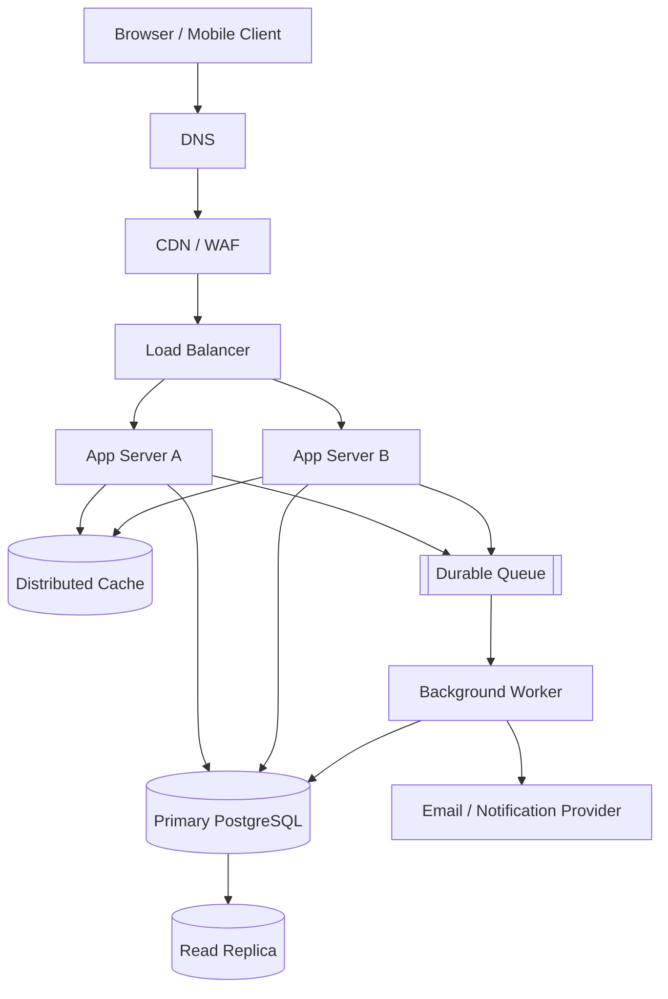

# QuickNotes System Architecture

## Requirements

### Functional

- Register and authenticate users securely.
- Create, read, update and delete notes scoped to the authenticated user.
- Create/list tags and attach tags to notes.
- Paginate and search notes; validate input and return consistent errors.
- Support account-level data isolation, audit events and recovery of deleted/changed data where required.

### Non-functional

- Target 99.9% monthly availability, with monitored latency and error-rate SLOs.
- Typical note-list read target: p95 under 300 ms; writes p95 under 500 ms at normal load.
- TLS in transit, encrypted storage/backups, managed secrets, least privilege and audit logging.
- Horizontal application scaling, backups with tested restore, and graceful degradation when cache/queue services fail.
- Rate limiting, observability, accessibility and privacy-aware retention.

## Load estimate: 1 million registered users

Planning assumptions (not a forecast): 1,000,000 registered users; 20% active on an average day (200,000 DAU); each active user makes 30 reads and 3 writes per day; peak traffic is 5× average; average stored note payload including metadata is 2 KB; each active user has 100 notes; storage growth assumes 10% more notes per year and excludes replicas/backups/index overhead.

- Reads/day = 200,000 × 30 = 6,000,000; average = 6,000,000 / 86,400 ≈ **69 reads/s**; estimated peak ≈ **347 reads/s**.
- Writes/day = 200,000 × 3 = 600,000; average = 600,000 / 86,400 ≈ **7 writes/s**; estimated peak ≈ **35 writes/s**.
- Initial note payload = 200,000 active users × 100 notes × 2 KB = 40 GB (decimal). At 10% annual growth, added note payload is roughly **4 GB/year** on this active-user assumption. If all 1 million registered users each store 100 notes, plan for about **200 GB initial note payload** and **20 GB/year** growth, before indexes, user/tag records, replicas and backups. Capacity planning should use measured distributions and retention policy.

## Architecture diagram

## Components and the problem each solves

- **Client:** renders the interface and gives users immediate feedback while keeping server validation authoritative.
- **DNS:** maps the public service hostname to the current edge endpoint so clients do not need fixed server addresses.
- **CDN/WAF:** caches static assets near users and filters common malicious traffic before it reaches the origin.
- **Load balancer:** health-checks targets and distributes requests across healthy app servers.
- **App servers A and B:** run stateless API logic and can scale horizontally or tolerate one instance failing.
- **Distributed cache:** reduces repeated reads and database load for hot, safe-to-cache data; correctness-sensitive writes invalidate/update cached entries.
- **Primary database:** provides transactional durable writes and enforces relational constraints.
- **Read replica:** serves eligible read traffic and provides a second copy for read scaling; replication lag means some reads must use the primary.
- **Durable queue:** buffers asynchronous jobs and absorbs spikes without making the user wait for non-critical work.
- **Worker:** retries idempotent background tasks such as notifications, audit exports and cleanup outside the request path.
- **Notification provider:** delivers email or other notifications without coupling delivery latency to the API response.

## GET /notes flow

1. Client sends `GET /v1/notes?limit=20` over HTTPS with its access token.
2. DNS resolves the hostname; CDN/WAF applies edge rules and forwards the dynamic API request to the load balancer.
3. Load balancer chooses a healthy app server; the server validates the token and extracts the user identity.
4. The app checks the cache using a user-scoped key. On a miss, it queries the read replica if bounded staleness is acceptable, otherwise the primary.
5. The database filters by `user_id`, orders by indexed creation time and returns a bounded page.
6. The app maps rows to the response contract, returns `200 OK` with JSON and a cursor, and may cache the result briefly.

## POST /notes flow

1. Client sends `POST /v1/notes` with JSON and an access token over HTTPS.
2. Edge protection and the load balancer route the request to a healthy app server.
3. The app authenticates the caller, validates title/body lengths, and derives `user_id` from the token rather than trusting the request body.
4. In a database transaction, the app inserts the note into the primary database and commits; relational constraints protect ownership and integrity.
5. The app invalidates or updates the user's cached note-list keys and publishes a durable background event (ideally via a transactional outbox so a committed write is not lost before enqueueing).
6. The app returns `201 Created` and the created note. A worker processes non-critical side effects such as notifications and retries transient failures idempotently.

## Trade-offs and failure handling

- **Cache vs. consistency:** caching lowers read latency and database load but can return stale data. Use short TTLs, user-scoped keys and write invalidation; route read-after-write requests to the primary when needed. If cache is down, bypass it and apply database protection/rate limits.
- **Read replica vs. freshness:** replicas increase read capacity but replication lag can briefly hide a new note. Keep writes on the primary and send consistency-sensitive reads there; monitor lag and stop routing to a lagging replica.
- **Synchronous vs. queued work:** a queue keeps notification or reporting failures from delaying note creation, but adds operational complexity and eventual consistency. Use durable messages, retries, dead-letter handling and idempotent workers.
- **Availability vs. operational simplicity:** multiple stateless app instances and health checks cost more than a single server but avoid application-instance failure taking down the service.

## Avoiding single points of failure

Run at least two app servers across separate availability zones behind a health-checking load balancer; use redundant DNS/CDN edge infrastructure; deploy the cache as a replicated managed cluster; configure database failover to a synchronous or appropriately monitored standby and maintain an independent tested backup; and use a replicated durable queue with worker replicas. The primary database is a write coordination point, so automatic failover, tested recovery objectives, connection retry logic and backup restoration drills are essential rather than assuming replicas alone eliminate every failure mode.
